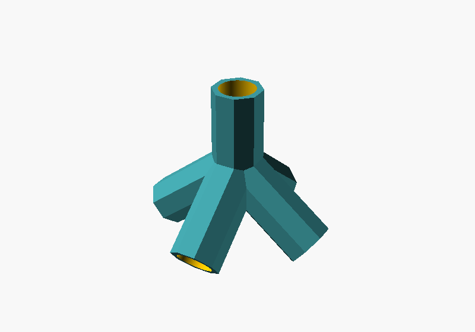

# rod-connectors

Printable hubs that join round rods at any angles, in OpenSCAD. Give each rod
a direction and a size; the hub gets a socket for each, ending at a solid
core so every rod seats against a floor.



## Use

```openscad
use <rod_connectors.scad>

rod_connector([
  rod([1, 0, -0.8]),
  rod([0, 1, -0.8], diameter=12.7),
  rod([0, 0, 1], screw=4),
]);
```

`rod_connector(rods, core=3)` builds the hub from a list of `rod()` values.
`core` is the least distance, in mm, from the centre to the bottom of any
socket.

`rod(dir, ...)` describes one rod. Only `dir` is required:

| Parameter | Default | Meaning |
|---|---|---|
| `dir` | | Direction from the hub's centre along the rod, any non-zero `[x, y, z]` |
| `diameter` | 25.4 | The rod's diameter, mm |
| `depth` | 50 | How far the rod goes into its socket |
| `wall` | 5 | Socket wall thickness |
| `clearance` | 0.2 | Added to the bore's diameter so the rod slides in |
| `inner_fn` | `$fn` | Facets of the bore |
| `outer_fn` | 8 | Facets of the outside; 8 prints with flat faces |
| `screw` | 0 | Diameter of a set-screw hole through the wall, halfway along the socket |
| `slot` | 0 | Width of a clamping slit from the socket's mouth to halfway down |
| `feature_angle` | 0 | Where around the rod the screw hole goes, degrees; the slot goes opposite |

Each rod can differ from the others: a hub can take a 1-inch post and a
10 mm stay.

### Directions

`dir` is a vector, and three functions give one from other descriptions
(angles in degrees):

| Function | Direction |
|---|---|
| `dir_spherical(theta, phi)` | `theta` down from +Z, `phi` around from +X |
| `dir_euler(roll, pitch, yaw)` | Where OpenSCAD's `rotate([roll, pitch, yaw])` takes +Z |
| `dir_quat([w, x, y, z])` | Where the quaternion's rotation takes +Z; it needn't be unit length |

A spherical `[length, theta, phi]` description's length is the rod's depth:
`rod(dir_spherical(theta, phi), depth=length)`.

## How deep the sockets start

A socket's bore starts some way out from the centre, so rods don't meet in
the middle. For two bores of radius R whose rods meet at angle a, each bore
starts at R / tan(a/2) + w / (2 sin(a/2)) from the centre, where w is the
thinner of the two walls. That keeps a full wall between the two bores, half
on each side of the plane between the rods. Each socket takes the largest
such distance over all the other rods, and at least `core`. Rods close in
angle push their sockets further out; rods pointing apart can start right at
the core.

`rod_connector_stop(rods, i, core)` returns that distance for rod `i`, and
`rod_body(rods, i)` draws the space rod `i` fills when fully home, for
checking a design.

## Examples

| File | What it makes |
|---|---|
| [`examples/hub_five_way.scad`](examples/hub_five_way.scad) | Five 1-inch rods: four legs splayed down, one post up |
| [`examples/corner_three_way.scad`](examples/corner_three_way.scad) | A cube-frame corner for three 3/4-inch rods |
| [`examples/mixed_rods.scad`](examples/mixed_rods.scad) | Three rod sizes, with a set-screw hole and a clamping slot |
| [`examples/tripod_spherical.scad`](examples/tripod_spherical.scad) | A tripod head, its legs placed with `dir_spherical` |

## Tests

`just test`, or `python3 tests/test_rod_connectors.py [OPENSCAD]`, renders
every example and probes several hubs with OpenSCAD. It checks that each part
is one solid, that a rod fits fully home and is stopped 1 mm further by its
socket's floor, that no two rods touch and a wall stands between every two
bores, that the screw hole and slot go through the wall, that the direction
functions agree with OpenSCAD's `rotate()` and the maths, and that bad input
is refused. `just images` renders the picture above.

## Licence

See [LICENSE](LICENSE).
